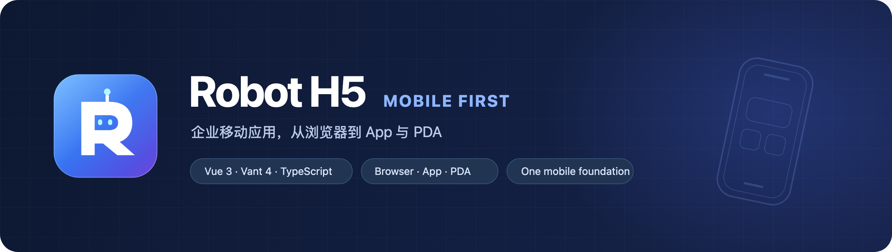
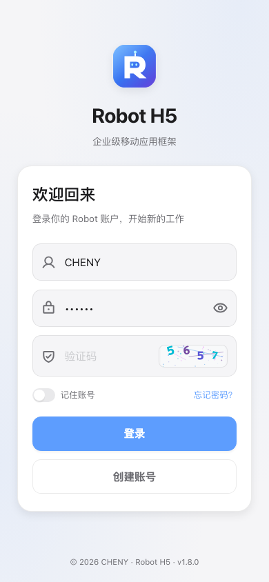
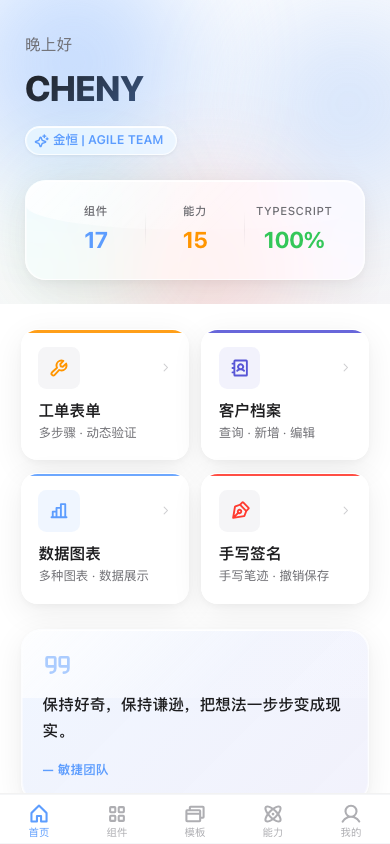
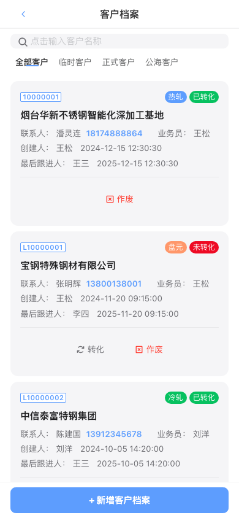
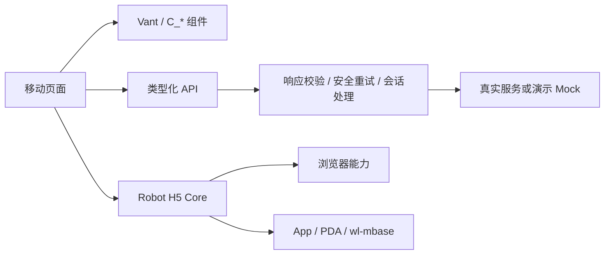

<!-- 封面由 SVG 原图导出：node scripts/render-readme-banner.mjs -->


<div align="center">
  <p><strong>一套移动应用底座，连接页面、业务与设备能力。</strong></p>
  <p>Vue 3 · TypeScript · Vite · Vant · UnoCSS · Pinia</p>
  <p>
    <a href="#快速开始">快速开始</a> ·
    <a href="#你能做什么">能力地图</a> ·
    <a href="#项目结构">项目结构</a> ·
    <a href="#接入业务">接入业务</a> ·
    <a href="#文档导航">文档导航</a>
  </p>
</div>

## 项目定位

Robot H5 是企业移动端 Vue 应用模板，面向独立浏览器、App/PDA WebView 和 wl-mbase 子应用。页面使用同一套组件与设计令牌，拍照、扫码、定位等能力由 `@robot-h5/core` 适配运行平台。

品牌标识将字母 **R** 与机器人的双眼、天线结合，使用蓝紫渐变。应用图标、登录页与加载屏复用 [logo.svg](./public/logo.svg)；README 使用由[封面 SVG](./docs/assets/robot-h5-banner.svg) 导出的高清 PNG。图片均保存在本仓库，使用原生 Markdown 相对路径引用。

> 企业 GitLab 图片访问异常的已验证结果与排查步骤见 [GitLab 图片访问排查](docs/README.gitlab.md)。本实例的 API 替代入口也已反馈 404，暂不作为可用的图片来源。

## 快速开始

需要 **Node.js 22.13+ 或 24.x**、**pnpm 11.8+**；推荐版本以 [.nvmrc](./.nvmrc) 为准。Node 下限与固定 pnpm 的引擎要求一致。

```bash
pnpm install --frozen-lockfile
pnpm dev
```

打开 **http://localhost:8888/robot-h5/login**。

| 本地演示 | 值 |
| --- | --- |
| 默认账号 | `CHENY` |
| 默认密码 | `123456` |
| 图形验证码 | 按图片输入；2 分钟有效，提交后失效 |
| 短信验证码 | 点击发送后使用 `123456`，5 分钟有效 |
| 桌面预览 | 390 × 844，与 wl-mbase 模拟器尺寸一致 |

默认开发环境开启 Mock。真实集成环境不注入演示接口，也不预填演示密码。记住账号只保存用户名，不保存密码。

创建自己的项目时，可使用 `pnpm setup` 初始化模板信息；配置入口是 [project.config.json](./project.config.json)。

## 你能做什么

| 模块 | 当前能力 | 状态 |
| --- | --- | --- |
| 账号 | 登录、图形验证码、注册、短信演示、找回密码、修改密码 | 可验证的 Mock 流程；上线需接真实账号服务 |
| 客户档案 | 列表搜索与筛选、详情、新增、编辑、转化、公海、作废 | 接口驱动的完整演示 |
| 个人中心 | 昵称、签名、性别、行业、头像和封面 | 保存后同步用户状态；图片支持演示持久化 |
| 外观 | 浅色/深色、跟随系统、主题色、字体大小、减少动态效果 | 全局同步与持久化 |
| 公共组件 | 表单、移动列表、弹层、导航、图标、头像等 | 分页支持刷新与失败重试 |
| 设备能力 | 拍照、定位、扫码、NFC、文件、签名、录音、蓝牙等 15 个 Hook | Core 统一适配；可用性取决于设备、权限和宿主 |
| wl-mbase | 免登、公司上下文、动态标题、原生返回、单头部 | 已集成；发布前需验证真实宿主 |
| 领域模板 | 设备、物流、计量等领域入口 | **规划中**，入口明确标注状态 |

> 开发 Mock 数据在服务运行期间保存在内存；演示构建在浏览器保存到 `robot-demo:*`。客户数据按账号与公司隔离。演示数据不代表真实后端接口已对接。

### 页面预览

| 登录 | 首页 | 客户档案 |
| :---: | :---: | :---: |
| [](docs/assets/login.png) | [](docs/assets/dashboard.png) | [](docs/assets/customer.png) |

## 项目结构

```text
Robot_H5/
├── src/
│   ├── api/              # 类型化接口，一业务模块一文件
│   ├── components/       # C_* 公共移动组件
│   ├── hooks/            # 分页、缓存、主题等组合函数
│   ├── platform/mbase/   # 宿主导航与公司上下文
│   ├── router/           # TabBar 与独立页面路由
│   ├── store/            # 用户、权限、主题、路由状态
│   ├── styles/           # 全局设计令牌与纯 Sass 工具
│   └── views/            # 首页、示例、账号、个人中心
├── mock/                 # 演示接口及独立数据仓库
├── types/                # 业务与组件类型
├── build/                # 环境配置和 Vite 插件
├── tests/                # 浏览器回归测试
├── scripts/              # 初始化、构建、契约与兼容性校验
└── docs/                 # 构建、宿主接入、设计与维护文档
```



## 接入业务

### 页面与路由

页面目录使用 `index.vue`、`index.scss`、`data.ts`：模板与交互、页面样式、类型与静态配置分开维护。公共类型放在 `types/`，通过 `#/*` 导入。

- TabBar 页面注册在 `src/router/menu.ts`，独立页面注册在 `src/router/modules.ts`。
- 路由 `name` 与 `defineOptions({ name })` 一致，配置 `meta.title`。
- 需要缓存的页面配置 `meta.keepAlive`；在 setup 中调用 `useScrollCache` 保存实际容器位置。
- App/PDA 业务根页配置 `meta.mbaseRoot`，标题由路由完成事件统一上报。

### 接口与数据

```ts
import { get, post } from '@/utils/http';
import type { Customer, CustomerInput } from '#/Customer/type';

export const getCustomerList = () => get<Customer[]>('/customer/list');
export const addCustomer = (data: CustomerInput) => post<Customer>('/customer', data);
```

默认返回响应中的 `data`；成功码兼容 `200` 和 `2000`，业务失败抛出 `ApiError`。完整业务响应通过 `returnEnvelope` 显式获取，原生响应通过 `isReturnNativeResponse` 获取。GET/HEAD 的临时网络故障等待重试结果；POST/PUT/DELETE 不自动重试。

真实业务应使用服务端约定的路径和字段替换演示接口。集成模式的公司相关请求使用 `withMbaseCompanyContext`，持久化业务缓存使用 `getMbaseCompanyScopedKey`。

### 样式与图标

- 颜色、圆角、阴影使用 `--ds-*` 令牌，见 [设计系统](./DESIGN_SYSTEM.md)。
- 全局 CSS 只加载一次；页面注入的 `styles/tools.scss` 只包含 Sass 工具。
- 外置 SCSS 使用 BEM 父级限定组件样式，不使用 SFC 的 `:deep()` 语法。
- 图标从源码收集为本地集合，支持离线。动态菜单新增图标加入 [iconify-extra.json](./src/plugins/iconify-extra.json)，未知图标显示本地兜底。
- 普通移动设备铺满屏幕；桌面使用手机预览容器；基座托管时遵循宿主尺寸和导航。

## 开发与发布

| 命令 | 用途 |
| --- | --- |
| `pnpm dev` | 本地 standalone + Mock 开发 |
| `pnpm dev:integrated` | SIT 宿主集成开发 |
| `pnpm type-check` | Vue / TypeScript 类型检查 |
| `pnpm lint:check` | 只读 ESLint 检查 |
| `pnpm template:validate` | 模板、环境与移动兼容性检查 |
| `pnpm test:e2e` | 登录、请求、分页、缓存、主题与 CRUD 回归 |
| `pnpm test:assets` | 构建后检查入口体积、全局样式重复与无效选择器 |
| `pnpm build:h5` | 按分支选择环境的标准 H5 构建 |
| `pnpm build:vercel` | 独立 Mock 演示构建 |
| `pnpm test:compat` | 检查旧 WebView 与宿主约定 |

首次运行浏览器测试前执行 `pnpm exec playwright install chromium`。CI 自动安装 Chromium，运行检查、构建和浏览器回归。

### 依赖维护

升级前查询官方版本与迁移说明，升级后验证类型、peer 约束、两种构建与浏览器回归。升级版本采用精确版本号，提交 `pnpm-lock.yaml`；CI 使用冻结锁文件安装。`pnpm deps:update` 提供交互选择，提交钩子调用项目内固定版本的 lint-staged。

本次核查及选择记录见 [依赖清单](./docs/dependency-audit.json)。TypeScript 使用提供编译器 API 的 6 系列；Vite 与 Mock 保留现有兼容链路；Node 类型匹配 Node 24。Pinia 4 的新内置 API、工具链大版本及新发布版本需要满足现有兼容和发布时间检查后再升级。

| 分支 / 环境 | 模式 | 部署路径 |
| --- | --- | --- |
| 本地 development | standalone + Mock | `/robot-h5/` |
| `sit` / SIT | integrated | `/mbase/robot-h5/` |
| `uat` / UAT | integrated | `/mbase/robot-h5/` |
| `pre` / PRE | integrated | `/mbase/robot-h5/` |
| `main` / PRD | integrated | `/mbase/robot-h5/` |
| vercel / DEMO | standalone + Mock | `/` |

环境唯一来源是 [build/environments.json](./build/environments.json)。上传地址使用环境配置，产物中的 `env.json` 提供版本身份；更新检测按实际部署路径读取该文件。

旧 `build:sit`、`build:test`、`build:uat`、`build:prod` 等入口保留兼容。正式流水线推荐统一执行 `pnpm build:h5`，详见构建文档。

## 文档导航

| 文档 | 解决什么问题 |
| --- | --- |
| [构建、环境与产物身份证](./docs/build-and-environments.md) | 分支构建、兼容入口、发布核验 |
| [wl-mbase 子应用集成](./docs/mbase-integration.md) | 免登、公司切换、能力桥、标题与返回协议 |
| [PDA 与旧 WebView 兼容](./docs/pda-compatibility.md) | CSS 回退、构建目标与真机验收 |
| [设计系统](./DESIGN_SYSTEM.md) | 颜色、字号、间距和 Liquid Glass 使用边界 |
| [API 约定](./src/api/README.md) | 接口组织、响应处理与 Mock |
| [AI 编码规范](./AGENTS.md) | 项目目录、路由、组件与交付检查 |

---

内部私有项目 · UNLICENSED · © Robot H5
